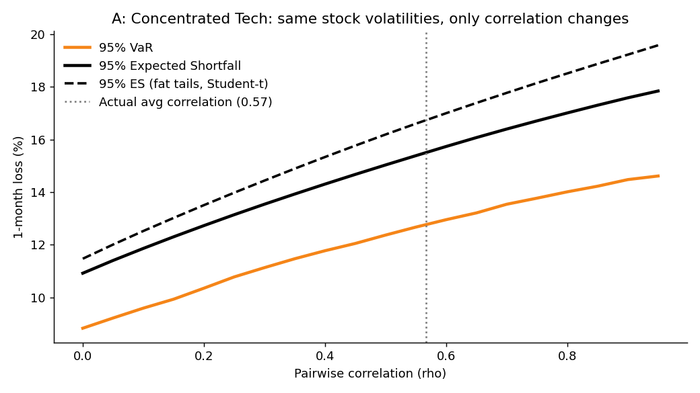

# Monte Carlo Portfolio Risk

**Correlation, not the stocks themselves, drives portfolio risk.**



*Same stock volatilities, only the correlation between them changes. Raising pairwise correlation from 0 to 0.95 lifts the 95% one-month VaR of a tech portfolio from 8.8% to 14.6% (+65%).*

---

## What this does

Takes a small stock portfolio, estimates returns, volatility and correlations from historical data, then simulates **10,000 correlated one-month futures**. The resulting loss distribution gives:

- **Value at Risk (VaR):** the loss that is not exceeded in 95% (or 99%) of months. "How much do I lose in a bad month?"
- **Expected Shortfall (ES):** the average loss in the months beyond VaR. "When it's that bad, how bad does it get?"

Two portfolios are compared on a $100,000 position:

| | Holdings | Annualized vol | Avg pairwise correlation |
|---|---|---|---|
| **A: Concentrated Tech** | AAPL 40%, MSFT 30%, NVDA 30% | 29%, 28%, 48% | 0.57 |
| **B: Diversified** | MSFT 40%, JNJ 30%, PG 30% | 28%, 19%, 19% | 0.38 |

---

## Method

1. **Data:** daily adjusted close prices from 2015-01-01 via `yfinance`.
2. **Returns:** daily log returns; covariance scaled to a 21-trading-day horizon.
3. **Drift:** set to zero. Historical mean returns are noise at a one-month horizon and distort the tail.
4. **Simulation:** correlated draws via Cholesky decomposition of the covariance matrix, 10,000 scenarios, two models:
   - **Normal:** standard multivariate normal.
   - **Student-t (df = 5):** multivariate t scaled to the same covariance, to capture fat tails.
5. **Portfolio return:** `w · (exp(R) − 1)` for each scenario, with fixed weights.
6. **Risk metrics:** VaR is the loss quantile; ES is the mean loss at or beyond it.
7. **Correlation sweep:** hold each stock's volatility fixed, replace the correlation matrix with a uniform pairwise ρ from 0 to 0.95, and re-measure VaR/ES using the same random draws.
8. **Validation:** closed-form parametric VaR cross-check, and a walk-forward backtest (252-day estimation window, non-overlapping months).

---

## Results

### Risk (1 month, $100,000)

| Portfolio | Model | VaR 95% | ES 95% | VaR 99% | ES 99% |
|---|---|---|---|---|---|
| A: Tech | Normal | 12.7% ($12,733) | 15.4% ($15,438) | 17.0% | 19.1% |
| A: Tech | Student-t | 12.3% ($12,252) | 16.7% ($16,656) | 19.1% | 24.3% |
| B: Diversified | Normal | 7.7% ($7,667) | 9.5% ($9,482) | 10.5% | 12.0% |
| B: Diversified | Student-t | 7.4% ($7,369) | 10.3% ($10,260) | 11.7% | 15.5% |

### Odds of a bad (or good) month (Normal model, zero drift)

| 1-month outcome | A: Tech | B: Diversified |
|---|---|---|
| Lose more than 5% | 25.9% | 14.3% |
| Lose more than 10% | 9.7% | 1.5% |
| Lose more than 20% | 0.2% | ~0% |
| Gain more than 10% | 13.8% | 2.8% |

Because drift is zero, profit probability is about 50% by construction. This is a risk map, not a forecast.

### Correlation experiment (volatility held constant, 95% VaR)

| Portfolio | ρ = 0 | ρ = 0.95 | Change |
|---|---|---|---|
| A: Tech | 8.8% | 14.6% | ×1.65 |
| B: Diversified | 6.1% | 9.8% | ×1.62 |

### Diversification benefit

Portfolio VaR vs the weighted sum of standalone stock VaRs: **A: 14%**, **B: 24%**.

### Validation

| Check | A | B |
|---|---|---|
| Monte Carlo VaR 95% vs parametric | 12.72% vs 13.63% | 7.66% vs 8.10% |
| Backtest breach rate, 95% VaR (129 months, expect 5%) | 3.1% | 2.3% |
| Backtest breach rate, 99% VaR (expect 1%) | 0.0% | 0.0% |

---

## Key takeaways

1. **Correlation alone moves risk a lot.** With stock volatilities fixed, going from uncorrelated to highly correlated raised 95% VaR by about 65% in both portfolios.
2. **Diversification only works when assets don't fall together.** B's diversification benefit (24%) is larger than A's (14%).
3. **Tails are fatter than the normal model says.** Student-t raises the 99% Expected Shortfall of A from 19.1% to 24.3%, and the odds of losing more than 20% in a month from 0.2% to 0.8%.
4. **The A vs B gap is not purely correlation.** NVDA (48% vol) is much more volatile than JNJ or PG (19%), so part of B's lower VaR is lower volatility. The correlation sweep isolates the correlation effect.

---

## Run it

Works in Google Colab or locally.

```bash
pip install yfinance numpy pandas matplotlib scipy
python monte_carlo_portfolio_risk.py
```

Edit the `PORTFOLIOS` dictionary at the top of the script to test your own tickers and weights. Charts and CSVs are written to `outputs/`:

| File | Content |
|---|---|
| `var_vs_correlation_a.png` / `_b.png` | VaR and ES vs correlation |
| `hist_a.png` / `hist_b.png` | Loss histogram with VaR/ES lines |
| `fan_a.png` / `fan_b.png` | Simulated 1-month paths with percentile bands |
| `correlation_heatmaps.png` | Correlation matrices |
| `portfolio_comparison.png` | VaR/ES by portfolio and model |
| `summary.csv`, `probability_table.csv` | Results tables |
| `simulation_a.csv`, `simulation_b.csv` | Simulated portfolio returns |

---

## Caveats

- **Historical estimates are noisy.** Covariances come from past data and change over time. Drift is set to zero because historical means are unreliable forecasts.
- **Correlations rise in crises.** Estimates from calm periods understate stress-period correlation, which is exactly the effect this project demonstrates.
- **Normal returns understate extremes.** Student-t (df = 5) helps, but it is an assumption, not a fitted distribution.
- **Backtest limits.** The sample (2015 onward) is mostly a rising market, and with about 129 monthly observations the 99% result (0 breaches) is not conclusive. Both models were conservative at 95% (breach rates below 5%).
- **Monte Carlo vs parametric VaR differ slightly** because simulated returns are compounded (`exp(R) − 1`) rather than treated as additive.
- **VaR is a threshold, not a worst case.** Expected Shortfall describes the severity beyond it.
- **Fixed weights, one-month horizon, no transaction costs, no rebalancing, no regime changes.**

*Educational risk model. Not investment advice.*

---

## Next steps

- Stress tests on historical crisis windows (2008, 2020)
- Equal-weight vs risk-parity allocation
- Time-varying volatility (GARCH)
- Interactive Streamlit app

---

Built by [Paschal](https://github.com/spocha27) · AGWANE Capital
